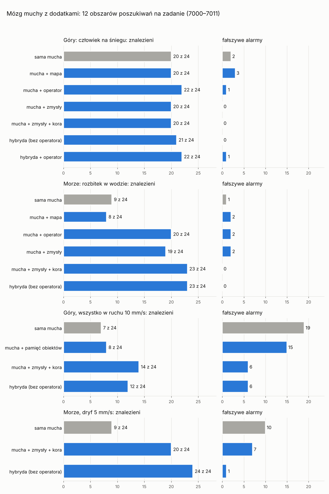

# Hybryda: mózg muchy z funkcjami dodanymi przez człowieka

Rdzeń drona to mucha: płat wzrokowy (model flyvis zbudowany na konektomie
oka) i ciało grzybkowate, które uczy się dopaminą, co lubić. Wokół rdzenia
dołożyliśmy pięć funkcji, których mucha nie ma. Każdą można włączyć albo
wyłączyć (`wingloop/dronomucha/dodatki.py`) i każdą zmierzyłem na tych samych
obszarach poszukiwań co samą muchę.

| dodatek | plik | co robi |
| --- | --- | --- |
| 1. zmysły w kielichu | `zmysly.py`, `hybryda.py` | temperatura z termowizji i odległość, wysokość i szerokość z dalmierza trafiają do ciała grzybkowatego obok obrazu z oka |
| 2. kora | `hybryda.py` (`Kora`) | klasyfikator (gradient boosting) daje drugą opinię o każdym widoku |
| 3. mapa | `mapa.py` | mapa prawdopodobieństwa, gdzie może być zaginiony, zamiast stałego wzoru lotu |
| 4. pamięć obiektów | `pamiec.py` | dron śledzi obiekty (gdzie są i dokąd jadą), a nie tylko miejsca |
| 5. operator | `operator.py`, `rozkaz.py` | gdy dron nie jest pewny, pyta człowieka; rozumie polecenia słowne |

W laboratorium doszły tylko opcjonalne gniazda, które domyślnie niczego nie
zmieniają:

- lekcje mogą zapisywać odczyty czujników (`senses=` w `tethered_training`
  i `flown_close_looks`);
- nawigator ma `planner` (skąd szukać dalej) i `memory` (czy w tym kierunku
  już był);
- ekran statusu ocenia widok przez `peek`, więc podgląd w filmie nie zadaje
  pytań operatorowi i nie dopisuje śladów do pamięci.

## 1. Zmysły w kielichu ciała grzybkowatego

**Problem.** Oko drona patrzy przez termowizję z automatycznym wzmocnieniem.
Widzi więc, co jest cieplejsze od czego, ale nie *jak* ciepłe. Nie wie też,
jak duży jest obiekt: bliska kozica i daleki człowiek zajmują w oku tyle
samo.

**Rozwiązanie.** U prawdziwej muchy kielich ciała grzybkowatego łączy węch,
smak, temperaturę i wzrok. Do kielicha dochodzą więc nowe „neurony
czuciowe”:

- **termowizja radiometryczna**, czyli temperatura w kelwinach ponad tłem;
- **dalmierz laserowy** z termowizją: odległość, wysokość i szerokość obiektu.

Każda wielkość to 10 linii, każda dostrojona do innej wartości. To kod
populacyjny, jak w prawdziwych neuronach czuciowych. Gdy czujnik nic nie
zmierzy, linie milczą. Ciało grzybkowate uczy się znaczenia tych linii tą
samą regułą dopaminową co obrazu. Nikt nie wpisuje reguły „człowiek ma
20 K”: mucha sama odkrywa, co znaczy „ciepły i długi”.

**Gimbal.** Pierwsza wersja mierzyła wzdłuż kursu, poziomo, i prawie zawsze
mierzyła pustkę. Dron leci poniżej metra nad ziemią, więc leżący człowiek
2–4 m dalej jest 15–25° poniżej horyzontu, a pozioma wiązka lasera
przechodzi nad nim. Teraz termowizja i dalmierz siedzą na gimbalu, jak w
prawdziwym dronie ratowniczym. Szukają najcieplejszego punktu w pasie ±4° od
kierunku, w który patrzy oko, i na niego kierują wiązkę.

**Lekcje.** To te same widoki co lekcje muchy (90 z uwięzi i 300 spojrzeń z
bliska, sprawdzone: identyczne cechy), przeleciane jeszcze raz z włączonymi
czujnikami. Zapisane są w `data/*_lekcje_zmysly.npz`.

Mediany odczytów ze spojrzeń z bliska:

| | temperatura, K | odległość, mm | wysokość, mm | szerokość, mm |
| --- | --- | --- | --- | --- |
| człowiek (góry) | 22,2 | 36 | 9,7 | 30 |
| kamień | 18,5 | 29 | 12,1 | 12 |
| kozica | 12,1 | 50 | 14,3 | 19 |
| rozbitek (morze) | 12,8 | 30 | 7,3 | 30 |
| foka | 5,2 | 28 | 7,4 | 26 |
| śmieci | 3,3 | 34 | 5,3 | 25 |

**Pomiar offline.** Walidacja krzyżowa na lekcjach, 5 części. Liczy się
spojrzenie z bliska, bo na nim dron decyduje o lądowaniu, i ocena z daleka,
bo na niej wybiera, do czego podlecieć.

Góry (112 spojrzeń na człowieka, 188 na resztę):

| mózg | z bliska: AUC | trafność przy 0 | przeoczenia | fałszywe alarmy | z daleka: AUC |
| --- | --- | --- | --- | --- | --- |
| sama mucha | 0,990 | 94% | 7 | 11 | 0,766 |
| mucha + zmysły ×1 | 0,999 | 98% | 4 | 1 | 0,918 |
| mucha + zmysły ×2 | 0,999 | 98% | 6 | 0 | 0,988 |
| **mucha + zmysły ×4** | **1,000** | **99%** | 4 | **0** | **0,969** |
| mucha + zmysły ×8 | 0,999 | 97% | 9 | 0 | 0,982 |

Morze (146 spojrzeń na rozbitka, 154 na resztę):

| mózg | z bliska: AUC | trafność przy 0 | przeoczenia | fałszywe alarmy | z daleka: AUC |
| --- | --- | --- | --- | --- | --- |
| sama mucha | 0,852 | 73% | 50 | 32 | 0,900 |
| mucha + zmysły ×1 | 0,984 | 93% | 16 | 5 | 0,869 |
| mucha + zmysły ×2 | 0,994 | 96% | 7 | 5 | 0,891 |
| **mucha + zmysły ×4** | **0,996** | **98%** | 5 | 1 | 0,906 |
| mucha + zmysły ×8 | 0,999 | 98% | 5 | 0 | 0,911 |

„×4” oznacza, że każda linia czujnika jest powtórzona 4 razy. Dzięki temu
więcej komórek Kenyona próbkuje zmysły, czyli zmysły dostają większą część
kielicha. Wybrałem ×4. Na morzu ×8 jest minimalnie lepsze, w górach gorsze.

## 2. Kora: druga opinia

Klasyfikator gradient boosting patrzy na te same 325 cech oka i surowe
odczyty czujników. Jego zdanie to `2p − 1`, czyli od −1 („to na pewno nie
cel”) do +1. Decyzja to walencja ciała grzybkowatego plus `waga ×` zdanie
kory (`hybryda.laczona`). Przy wadze 0,3 oba głosy mają mniej więcej równą
siłę.

| mózg | góry: z bliska AUC / przeoczenia / fałszywe | z daleka | morze: z bliska AUC / przeoczenia / fałszywe | z daleka |
| --- | --- | --- | --- | --- |
| sama mucha | 0,990 / 7 / 11 | 0,766 | 0,852 / 50 / 32 | 0,900 |
| sama kora | 1,000 / 2 / 0 | 0,994 | 0,995 / 0 / 1 | 1,000 |
| mucha + kora 0,3 | 0,999 / 2 / 1 | 0,992 | 1,000 / 0 / 1 | 1,000 |
| mucha + zmysły ×4 + kora 0,1 | 1,000 / 2 / 0 | 0,974 | 1,000 / 2 / 0 | 0,970 |
| **mucha + zmysły ×4 + kora 0,3** | **1,000 / 2 / 0** | **0,979** | **1,000 / 0 / 1** | **1,000** |
| mucha + zmysły ×4 + kora 1 | 0,996 / 2 / 0 | 0,964 | 1,000 / 0 / 1 | 1,000 |

Wniosek z pomiarów offline: sama kora już prawie wszystko rozróżnia, a
mucha ze zmysłami dochodzi blisko niej. Połączenie jest najpewniejsze
(najmniej pomyłek naraz z bliska i z daleka). Wybrałem więc
**zmysły ×4 i korę 0,3**.

## Wyniki w locie

Egzamin jak w docs/ratownictwo.md: 12 obszarów, których dron nigdy nie
widział (7000–7011), po 2 cele w każdym, czyli 24 cele. Misja trwa
maksymalnie 90 s. „Fałszywe alarmy” to lądowania na czymś innym niż cel,
czyli w prawdziwej akcji wysłanie ratowników do kamienia albo foki. Sama
mucha powtórzyła dokładnie dawne wyniki (20/2 i 9/1), więc pomiar jest
powtarzalny.



### Świat nieruchomy

| zestaw | góry: znalezione / alarmy | morze: znalezione / alarmy | morze: mediana pierwszego znaleziska |
| --- | --- | --- | --- |
| sama mucha | 20 / 2 | 9 / 1 | 13,6 s |
| mucha + mapa | 20 / 3 | 8 / 2 | 15,0 s |
| mucha + operator | 22 / 1 | 20 / 2 | 21,3 s |
| mucha + zmysły | 20 / 0 | 19 / 2 | 12,6 s |
| mucha + zmysły + kora | 20 / 0 | 23 / 0 | 7,0 s |
| **hybryda** (zmysły, kora, mapa, pamięć) | **21 / 0** | **23 / 0** | **7,1 s** |
| hybryda + operator² | 22 / 1 | – | – |

Hybryda była latana kilka razy, po każdej poprawce mapy. W nieruchomym
świecie wyszło 22/1, 22/0 i 21/0 w górach oraz 24/0, 24/0 i 23/0 na morzu.
W tabeli jest ostatnia wersja, ta w repozytorium.

² Z pierwszą wersją mapy.

### Świat w ruchu

W górach wszystko porusza się z prędkością 10 mm/s (0,5 m/s, idący
człowiek). Na morzu wszystko dryfuje z prędkością 5 mm/s (0,25 m/s, prąd
morski).

| zestaw | góry: znalezione / alarmy | mediana pierwszego | morze: znalezione / alarmy | mediana pierwszego |
| --- | --- | --- | --- | --- |
| sama mucha | 7 / 19 | 45,8 s | 9 / 10 | 27,8 s |
| mucha + pamięć obiektów | 8 / 15 | 47,4 s | – | – |
| mucha + zmysły + kora | 14 / 6 | 23,1 s | 20 / 7 | 7,8 s |
| **hybryda** | **12 / 6** | 19,2 s | **24 / 1** | 7,8 s |

Ta sama hybryda, latana cztery razy z kolejnymi poprawkami mapy, dała:

- na morzu 23/2, 22/4, 21/3 i 24/1;
- w górach 10/6, 10/6, 13/4 i 12/6.

Różnica 2–3 celów jest więc szumem tego pomiaru, a nie efektem poprawek.

## 3. Mapa prawdopodobieństwa

Ratownicy planują poszukiwania na mapie prawdopodobieństwa. To teoria
poszukiwań Koopmana, na której opiera się planowanie według IAMSAR:

- każda komórka ma szansę, że jest w niej zaginiony;
- spojrzenie stamtąd, które nic nie znalazło, obniża tę szansę o
  prawdopodobieństwo wykrycia (wzór Bayesa);
- następne miejsce to to, gdzie da się pokryć najwięcej prawdopodobieństwa
  w stosunku do czasu dolotu i rozglądania.

Rozkład początkowy to pierścień wokół miejsca, gdzie widziano zaginionego
ostatni raz. Statystyki zaginięć mówią, jak daleko ludzie odchodzą, ale nie
w którą stronę. Mapa liczy każde rozglądanie się, gdziekolwiek do niego
doszło, a nie tylko w punktach wzoru.

**Wynik:**

- **Znalezisk nie przybywa.** W górach 20 z 24, jak bez mapy, a na morzu
  8 zamiast 9 (szum). Cele, których dron nie znajduje, zwykle widzi, tylko
  źle rozpoznaje. Mapa nie pomaga, gdy problemem jest rozpoznanie, a nie
  przeszukanie.
- **Czas.** W górach dron kończy, gdy w terenie zostało poniżej 5%
  prawdopodobieństwa: średnio po 67 s zamiast 89 s, czyli o 25% krócej,
  przy tych samych znaleziskach. To realny zysk w akcji: bateria i czas na
  następny obszar. Na morzu, gdzie zasięg wykrycia jest mniejszy (50 mm
  zamiast 70), mapa nie zdąży uznać terenu za przeszukany i dron szuka do
  końca.
- **W modelu** (bez lotu) mapa i rozszerzający się kwadrat pokrywają tyle
  samo prawdopodobieństwa po 8 punktach. Kwadrat IAMSAR jest więc dla
  pierścienia prawie optymalny, ale mapa robi to po krótszej drodze (432 mm
  zamiast 600).

**Lekcja z ruchu.** Pierwsza mapa zakładała nieruchome cele: teren raz
przeszukany uznawała za pusty. W ruchu kończyła więc szukanie po 53–87 s,
choć cele wciąż krążyły po terenie. Teraz:

- prawdopodobieństwo „rozpływa się” z czasem z prędkością, z jaką poruszają
  się obiekty śledzone przez pamięć (punkt 4), jak przy liczeniu dryfu
  rozbitka (rozmycie nie zależy od tego, jak często mapa jest
  aktualizowana);
- miejsce przeszukane dawniej niż 15 s temu znowu jest warte spojrzenia;
- teren z ruchomymi celami nigdy nie jest „na pewno pusty”, więc dron szuka
  do końca.

Wynik mieści się w szumie pomiaru: w górach przy ruchu 10/6 przed
poprawką, 12–13 / 4–6 po niej. Bez mapy mucha z pamięcią szuka i tak do
końca misji, więc mapa w ruchu nie szkodzi, ale też wyraźnie nie pomaga.
Mapa bez pamięci obiektów nie zna prędkości celów. Przy ruchu trzeba ją
podać: `Mapa(ruch=...)`, np. prędkość prądu z prognozy.

## 4. Pamięć obiektów zamiast miejsc

Mucha pamięta miejsca: gdzie wylądowała i gdzie coś odrzuciła. W
nieruchomym świecie to to samo co pamięć obiektów, w ruchomym nie.
Odrzucony obiekt wjeżdża w nowe miejsce i dron ocenia go od nowa, a cel,
który wjechał w miejsce odrzucone, przestaje być oglądany.

`pamiec.py` daje każdemu obiektowi, na który patrzy oko, ślad. Położenie
mierzy gimbal z dalmierzem, a z kolejnych namiarów wynika prędkość. „Już
tam byłem” znaczy wtedy: „w tym kierunku jest teraz obiekt, który
sprawdziłem”, wszędzie tam, dokąd pojechał.

**Wynik.**

- **Sama pamięć przy samej musze prawie nic nie daje:** 8/15 zamiast 7/19.
  Mucha przy ruchu przede wszystkim źle rozpoznaje: ruch zmienia sygnaturę
  obiektu w detektorach ruchu oka (zmierzone już wcześniej w laboratorium).
- **Pamięć działa, gdy rozpoznanie jest dobre:**
  - na morzu z dryfem zmysły i kora bez pamięci i mapy mają 20/7, a z
    pamięcią i mapą 21–24 / 1–4, czyli 2–7 razy mniej fałszywych alarmów;
  - w górach 14/6 wobec 12–13 / 4–6, czyli bez wyraźnej różnicy.
- **Ślady mają swoje błędy.** Gimbal trafia w bliższy koniec obiektu, a ten
  zmienia się z kątem patrzenia. Dlatego pamięć ocenia prędkość na około
  7 mm/s przy prawdziwych 10, a dron czasem wraca do tej samej osoby.

## 5. Pewność i rozmowa z człowiekiem

Każde spojrzenie z bliska to zgłoszenie (`Operator.zgloszenia`): co to
jest, jak bardzo dron jest pewny (0–1) i gdzie to jest. Tyle wysyła
ekipie dron ratowniczy.

Gdy ocena jest blisko progu (|walencja| < 0,1), dron nie decyduje sam.
Zawisa, wysyła obraz i pyta operatora: „czy to człowiek?”. Operator jest
tu symulowany: osoba, która patrząc na termowizję z bliska, ma rację w 95%
przypadków i odpowiada po 5 s. Ten czas jest odejmowany od misji.

| | pytania na 12 misji | błędne odpowiedzi | znalezione / alarmy |
| --- | --- | --- | --- |
| góry, mucha bez operatora | – | – | 20 / 2 |
| góry, mucha + operator | 16 | 0 | 22 / 1 |
| morze, mucha bez operatora | – | – | 9 / 1 |
| morze, mucha + operator | 35 | 3 | **20 / 2** |
| góry, hybryda + operator² | **0** | – | 22 / 1 |

Kilka pytań na misję (1–3, po 5 s) daje samej musze tyle co zmysły: na
morzu ponad dwa razy więcej znalezionych. Hybryda nie pyta wcale, bo jej
oceny leżą daleko od progu. Jest pewna siebie i w nieruchomym świecie
słusznie: 0 fałszywych alarmów. Dwa cele, których nie znajduje w górach,
odrzuca już z daleka, a operator pyta tylko przy spojrzeniu z bliska.

**Polecenia słowne** (`rozkaz.py`). Dron rozumie polskie polecenie i dobiera
zadanie i dodatki po rdzeniach słów. Jeśli nie rozumie, mówi to wprost,
zamiast zgadywać. Rozpoznawanie mowy przed nim zrobi z tego polecenie
głosowe.

```
python -m wingloop.dronomucha rozkaz "Szukaj rozbitka na morzu, pytaj mnie, gdy nie jesteś pewien"
Zrozumiałem: morze: rozbitek w wodzie; dodatki: operator.
```

## Czego się nauczyłem

1. **Najwięcej daje nowy zmysł, a nie większy mózg.** Wcześniej więcej
   komórek Kenyona i zespoły mózgów dawały 0,00x AUC. Temperatura i
   rozmiar w kielichu dają na morzu skok z 9 do 19 znalezionych, bo
   niosą informację, której oko muchy nie ma.
2. **Mucha uczy się nowych zmysłów sama.** Nikt nie wpisał reguły
   „człowiek ma 20 K i 30 mm”. Ta sama reguła dopaminowa co dla obrazu
   nauczyła się ich znaczenia z tych samych lekcji.
3. **Kora pomaga najbardziej tam, gdzie mucha jest najsłabsza:** morze
   19 → 23 przy zerze alarmów. W górach mucha ze zmysłami już nie myli
   się na lekcjach, więc kora nie ma czego poprawiać.
4. **Każdy dodatek trzeba mierzyć w locie.** Mapa i pamięć brzmiały
   dobrze, a mierzalnie pomagały tylko w konkretnych warunkach (czas
   w górach, alarmy na morzu w ruchu). Pierwsza mapa w ruchu wręcz
   szkodziła. Przegląd kodu znalazł potem w mapie z dryfem cztery błędy;
   po poprawkach wyniki zostały w granicach szumu.
5. **Człowiek w pętli to tani i mocny dodatek** dla mózgu, który wie,
   kiedy nie wie.

## Co dalej

- **Głębokość obiektu.** Człowiek leżący wzdłuż linii wzroku, „od stóp”,
  jest z przodu wąski jak kamień. Termowizja i dalmierz mierzą szerokość,
  ale nie długość w głąb. Na tym polegają oba przeoczenia w górach (obszar
  7006). Skan głębi wzdłuż plamy ciepła, jak w LIDAR-ze, albo drugie
  spojrzenie z boku, gdy coś jest ciepłe, ale wąskie.
- **Lekcje w ruchu** dla kory i ciała grzybkowatego. Ruch psuje obraz w oku,
  ale nie temperaturę ani rozmiar. Lekcje z ruchomymi obiektami nauczyłyby
  oba mózgi, co w ruchu się nie zmienia.
- **Operator dla hybrydy** z progiem dobranym do jej skali ocen. Teraz nie
  pyta nigdy, a dwa jej przeoczenia to odrzucenia z daleka.
- **Sprzęt.** Rdzeń muchy jest mały i działałby w czasie rzeczywistym na
  pokładowym komputerze (Jetson) albo na układzie neuromorficznym (Loihi,
  SpiNNaker), a kora na tym samym komputerze.

## Polecenia

```
python -m wingloop.dronomucha szukaj ratunek_morze --obszary 12 --zestaw hybryda
python -m wingloop.dronomucha szukaj ratunek_gory --zmysly 4 --kora 0.3 --operator
python -m wingloop.dronomucha szukaj ratunek_morze --zestaw hybryda --ruch 5
python -m wingloop.dronomucha film ratunek_morze --zestaw hybryda --plik hybryda.mp4
python -m wingloop.dronomucha rozkaz "Znajdź turystę w górach, użyj wszystkiego"
```

Lekcje ze zmysłami (`data/*_lekcje_zmysly.npz`) są w repozytorium. Nowe
zadanie nagra je samo przy pierwszym `szukaj` z dodatkami, w około 30
minut na 4 rdzeniach.
