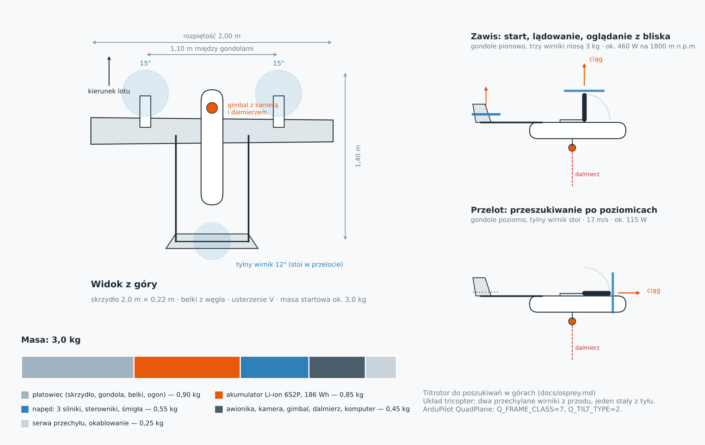

# Dron jak Osprey: tiltrotor do poszukiwań w górach

Mamy dwie platformy i każda ma jedną dużą wadę:

- **quadrocopter** zawisa i ogląda z bliska, ale lata 13 minut i przeszukuje
  11–16% kilometra kwadratowego;
- **samolot piankowy** przeszukuje cały kilometr, ale startuje z ręki, ląduje
  na brzuchu (w Tatrach na kamieniach) i nie zatrzyma się nad kandydatem.

Bell-Boeing V-22 Osprey łączy obie rzeczy: startuje i zawisa jak śmigłowiec,
a potem przechyla wirniki do przodu i leci jak samolot. Ten dokument opisuje,
jak zbudować małego drona, który działa tak samo, i porównuje go z dwiema
platformami, które mamy: arytmetyką i pomiarem w tej samej symulacji
(`docs/teren.md`).

## Jak to robi Osprey i co da się przenieść na drona

V-22 ma dwa duże wirniki w gondolach na końcach skrzydeł. Gondole obracają
się o około 90° od pionu do poziomu. W zawisie Osprey steruje się jak
śmigłowiec: skokiem ogólnym i okresowym łopat przez tarczę sterującą.

W małym dronie tarcza sterująca to drogi, delikatny i trudny do strojenia
mechanizm. Drony typu tiltrotor sterują więc inaczej:

- **przechylenie na boki:** różnica ciągu lewego i prawego wirnika;
- **pochylenie przód–tył:** trzeci wirnik z tyłu albo wychylenie gondol;
- **odchylenie (yaw):** gondole wychylone w przeciwne strony.

## Możliwe układy

| układ | jak wygląda | zawis w wietrze | złożoność | ArduPilot |
| --- | --- | --- | --- | --- |
| **bicopter tiltrotor** | dokładnie jak Osprey: 2 wirniki | **słaby**: pochylenie tylko przez wychył gondol względem środka ciężkości | średnia, bardzo czuły na środek ciężkości | `Q_FRAME_CLASS=10`, `Q_TILT_TYPE=3` |
| **tricopter tiltrotor** | 2 przechylane wirniki z przodu, 1 stały z tyłu | dobry: tylny wirnik daje pochylenie | średnia | `Q_FRAME_CLASS=7`, `Q_TILT_TYPE=2` (odchylenie przednimi gondolami) |
| quad tiltrotor | 4 przechylane | bardzo dobry | wysoka: 4 serwa | obsługiwany, wektorowy yaw bywa kłopotliwy |
| lift + cruise | 4 stałe pionowe + pchający | bardzo dobry | **najniższa** | standardowy QuadPlane |
| tailsitter | startuje na ogonie | słaby, kamera w zawisie patrzy w bok | niska | obsługiwany |

**Wybór: tricopter tiltrotor.** Wygląda i lata jak Osprey: dwa duże wirniki w
gondolach przechylają się do przodu. Tylny wirnik daje sterowność w zawisie,
której brakuje bicopterowi, a w przelocie stoi, więc nie zużywa energii.
ArduPilot obsługuje ten układ w trybie QuadPlane, a hobbyści budują go na
skrzydłach klasy 1,5–2 m.

Uczciwie: **najprostszy byłby lift + cruise**, bo nie ma w nim ruchomych
części poza sterami. Kosztem są cztery silniki, które w przelocie wiozą się
bez pracy i stawiają opór. Proponuję go jako etap pośredni (patrz „Plan
budowy”).

## Projekt

**Płatowiec**

| element | parametry | masa |
| --- | --- | --- |
| skrzydło | 2,0 m rozpiętości, cięciwa 0,22 m, płat wysoko | 0,55 kg |
| gondola kadłubowa | z gimbalem 2-osiowym na kamerę pod spodem | 0,20 kg |
| belki i ogon | dwie belki z węgla do usterzenia V; na belce poprzecznej tylny silnik | 0,15 kg |

**Napęd**

| element | parametry | masa |
| --- | --- | --- |
| przód | 2 × silnik klasy 3515, ok. 450 KV, śmigło 15", w gondolach na krawędzi natarcia, ±0,55 m od osi | 0,40 kg |
| serwa przechyłu | 2 × metalowe, zakres 0–100° (lekko w tył dla odchylenia) | 0,08 kg |
| tył | silnik klasy 2814, śmigło 12", w przelocie stoi | 0,15 kg |

**Zasilanie:** akumulator Li-ion 6S2P z ogniw 21700, ok. 8,4 Ah, czyli 186 Wh.
Waży 0,85 kg. Ogniwa Li-ion mają mniejszy prąd niż LiPo, ale w przelocie i
tak potrzeba tylko kilku amperów.

**Awionika i ładunek**

| element | co to | masa |
| --- | --- | --- |
| kontroler lotu | ArduPilot (Pixhawk albo H743), GPS, czujnik prędkości powietrza | 0,45 kg razem z wierszami poniżej |
| dalmierz | TF03-180 | |
| kamera | termowizja T256s albo 384×288 | |
| komputer pokładowy | z mózgiem muchy (`docs/lekka.md`) | |
| przewody | | 0,17 kg |

**Razem: około 3,0 kg.**

## Fizyka: ile kosztuje zawis

Liczy `platformy.moc()` i `platformy.gestosc()`:

- **Powietrze w Tatrach** na 1800 m przy 0 °C ma gęstość 1,04 kg/m³ zamiast
  1,23 nad morzem. Zawis kosztuje tam o 8–9% więcej.
- **Zawis** liczony z teorii strumieniowej: P = T^1,5 / √(2ρA) / FM / η.
  - ciąg T = 29,4 N;
  - dyski wirników A = 0,30 m²;
  - FM = 0,6, napęd 75%;
  - wynik: **460 W**.
- **Przelot:** P = W · v / (L/D) / η_śmigła / η_napędu.
  - L/D = 10 (gondole i podwozie psują opływ);
  - v = 17 m/s, śmigło 65%, napęd 75%;
  - wynik: **115 W**.
- **Minuta zawisu kosztuje 4 minuty przelotu** (`VTOL.zawis_koszt = 4`).
- **Czas lotu:** 186 Wh × 80% = 149 Wh, co daje 78 minut samego przelotu.
  Przyjmujemy **60 minut**, z zapasem na wiatr, wznoszenie i zimny akumulator.

Te same rachunki dla platform, które już mamy:

| platforma | masa | zawis | przelot |
| --- | --- | --- | --- |
| quadrocopter | 1,6 kg, 4 × 10" | 225 W | – |
| samolot | 1,7 kg | – | 59 W (L/D 11, 15 m/s) |

To zgadza się z ich czasami lotu (13 i 40 min) przy akumulatorach LiPo
45–50 Wh.

## W symulacji

Tiltrotor jest trzecią platformą (`PLATFORMY["vtol"]`, `lot.py`). Lot wygląda
tak:

1. Startuje pionowo w zawisie, a od 30 m nad ziemią przechyla wirniki i
   rozpędza się z 3 m/s² do 17 m/s.
2. Przeszukuje po poziomicach jak samolot.
3. Przy kandydacie wraca do zawisu, schodzi na 35 m i trzy razy ogląda go z
   góry jak quad.
4. W zawisie wznosi się, jeśli trzeba, do 30 m i wraca do przelotu.

Bateria liczy się energią: każda sekunda zawisu kosztuje 4 sekundy przelotu.

Wyniki na tych samych obszarach, tą samą kamerą T256s z 60 m (jesienią,
20 obszarów, 35 osób):

| platforma, jak ogląda z bliska | znalezieni | fałszywe alarmy na lot | przeszukane | czas lotu |
| --- | --- | --- | --- | --- |
| samolot, przelot na 35 m | **25/35 = 71%** [55–84] | 0,80 | 96% | 33 min |
| **tiltrotor, zawis na 35 m** | **21/35 = 60%** [44–74] | 0,75 | 98% | 30 min |
| tiltrotor, zawis na 15 m | 16/35 = 46% [30–62] | **0,20** | 97% | 32 min |
| quad, zawis na 15 m | 10/35 = 29% [16–45] | **0** | 16% | 12 min |

Z kamerą 384×288 ze 100 m samolot znajduje 71% (0,35 alarmu na lot), a
tiltrotor z zawisu na 15 m 66% (0,85).

**Najważniejsze odkrycie: zawis na 15 m szkodzi.** Mózg uczony na kamerze
T256s odrzucał z 15 m, prosto z góry, wszystkich siedzących i stojących (0 z
11), tak samo na quadzie i na tiltrotorze. Samolot, który przelatuje na 35 m
i widzi ich trochę z boku, potwierdzał 9 z 11. Z góry siedzący człowiek to
okrągła plama głowy, czapki i ramion, podobna do grzbietu kozicy. Z 35 m
tiltrotor potwierdza 7 z 11 i znajduje 60% zamiast 46%.

Dlatego tiltrotor ogląda teraz domyślnie z 35 m (`lot.NIZEJ["vtol"]`). Ten sam
wniosek dotyczy quada: jego 15 m też warto podnieść albo pochylić kamerę.

**W mrozie i upale tiltrotor z 15 m wypada źle:**
- mróz: 3 z 25 osób, 12%, wobec 57% samolotu;
- lato: 0 z 25 osób, ponad 2 fałszywe alarmy na lot, wobec 34% samolotu.

Z 35 m (20 obszarów, 35 osób, `docs/teren.md`, „Nauka: ciepłe dni” i
„Nauka: własne loty”). Liczby w kolejności: lekcje wersji 3, potem nowe
lekcje, potem lekcje z własnych lotów:
- jesień: 60%, 66%, 77% (fałszywe alarmy na lot: 0,75, 1,85, 0,35);
- mróz: 51%, 80%, 83% (0,05, 1,45, 0,05);
- lato: 34%, 40%, 34% (2,05, 2,05, 0,45);
- upał (+27 °C): 17%, 34%, 20% (3,20, 2,80, 1,00).

**Bateria:** tiltrotor przeszukuje cały kilometr w około 30 minut i zużywa
przy tym około dwóch trzecich akumulatora (przelot plus 12 przejść i ok.
2 min zawisu, liczone ×4). Zostaje zapas na wiatr albo na drugi obszar.

## Porównanie trzech platform

| | quadrocopter | samolot piankowy | **tiltrotor** |
| --- | --- | --- | --- |
| masa | 1,6 kg | 1,7 kg | 3,0 kg |
| czas lotu | 13 min | 40 min | 60 min przelotu, zawis ×4 |
| prędkość przeszukiwania | 8 m/s | 15 m/s | 17 m/s |
| przeszukane w symulacji (1 km²) | 16% | 96–99% | 97–98% |
| znalezieni (T256s, 20 obszarów) | 29% | **71%** | 60% |
| fałszywe alarmy na lot | **0** | 0,80 | 0,75 |
| start | pionowo, z ziemi | z ręki, z rozbiegu | **pionowo, z ziemi** |
| lądowanie | pionowo, gdziekolwiek | na brzuchu, trzeba miejsca bez kamieni | **pionowo, gdziekolwiek** |
| oglądanie z bliska | zawis, tanio | przelot, czasem kilka nawrotów | zawis, drogo (×4) |
| wiatr | słabo przy 8 m/s | dobrze | dobrze w przelocie, słabo w zawisie i przejściu |
| budowa i strojenie | proste | proste | trudne: serwa, przejścia |
| koszt części (bez kamery) | najmniejszy | mały | ok. 2× samolot |

**Wniosek.** Tiltrotor łączy obie platformy w jednej. Przeszukuje cały
kilometr kwadratowy jak samolot, ale startuje i ląduje pionowo, czyli przy
schronisku, na polanie albo na grani. Nad kandydatem zatrzymuje się jak
quad. W Tatrach, gdzie samolot nie ma gdzie bezpiecznie wylądować, to
największa zaleta.

W symulacji znajduje mniej niż samolot (60% wobec 71%), bo jedno spojrzenie
z zawisu prosto z góry daje mniej niż kilka zdjęć z przelotu pod kątem.
Następny krok to kamera pochylona do przodu przy potwierdzaniu.

Proponuję podział ról:
- **samolot** do przeszukiwania;
- **tiltrotor** jako docelowa jedna platforma, gdy przejścia będą opanowane;
- **quad** do sprawdzania okolic szlaku i nauki.

## Ryzyka tiltrotora

- **Przejście** z zawisu do przelotu i z powrotem to najtrudniejsza faza.
  Przy porywach wiatru w górach skrzydło może utracić siłę nośną, zanim
  wirniki zdążą się przechylić. ArduPilot pozwala ustawić tempo przechyłu i
  minimalną prędkość przejścia; trzeba to strojenie przećwiczyć nisko i nad
  płaskim terenem.
- **Serwo przechyłu to pojedynczy punkt awarii.** Zablokowana gondola w
  połowie przejścia zwykle kończy się rozbiciem. Potrzebne są metalowe serwa
  z zapasem momentu i kontrola ich prądu.
- **Zawis jest drogi**, a wiatr 8–10 m/s w Tatrach jeszcze go podraża.
  Tiltrotor powinien zawisać tylko do potwierdzania, a nie przeszukiwać z
  zawisu.
- **Przepisy:** przy 3 kg to kategoria otwarta A3 (z dala od ludzi) albo
  szczególna. Rejestracja operatora i szkolenie są potrzebne tak samo jak
  przy samolocie 1,7 kg.
- **Koszt i czas budowy** są mniej więcej dwa razy większe niż przy samolocie.

## Plan budowy

1. **Quad (jest):** oprogramowanie, mózg, kamera i ArduPilot w zawisie.
2. **Samolot piankowy:** przelot po poziomicach i terrain following.
3. **Lift + cruise** na tym samym skrzydle 2 m: QuadPlane w ArduPilocie i
   przejścia bez ruchomych gondol. Najtańszy sposób, żeby nauczyć się
   przejść.
4. **Tiltrotor:** te same skrzydło i elektronika, tylko przednie silniki
   przeniesione do przechylanych gondol, a tylny zostaje. Zysk to mniejsza
   masa i opór w przelocie, czyli dłuższy lot.
